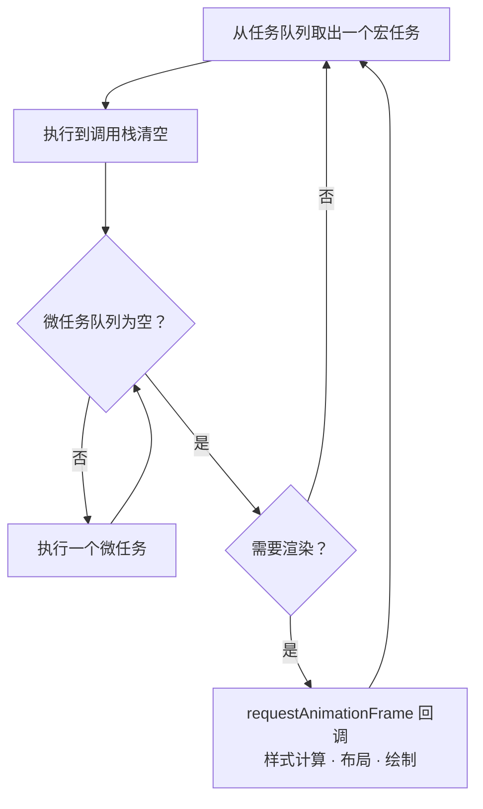

JavaScript 是单线程的，但我们每天都在写异步代码。让这一切成立的，是**事件循环**（Event Loop）。

## 一个经典的问题

下面这段代码会按什么顺序输出？

```js title="order.js"
console.log('1: script start');

setTimeout(() => console.log('2: setTimeout'), 0);

Promise.resolve()
  .then(() => console.log('3: promise 1'))
  .then(() => console.log('4: promise 2'));

queueMicrotask(() => console.log('5: microtask'));

console.log('6: script end');
```

> [!question]- 先自己想一想，再展开看答案
> ```
> 1: script start
> 6: script end
> 3: promise 1
> 5: microtask
> 4: promise 2
> 2: setTimeout
> ```
> 同步代码先执行完；然后**清空微任务队列**（包括执行过程中新加入的微任务）；最后才轮到下一个宏任务。

## 事件循环的一轮



关键点只有三条：

1. 每轮只执行**一个**宏任务（script、`setTimeout`、I/O、UI 事件……）。
2. 宏任务结束后，微任务队列会被**一次性清空**（`Promise.then`、`queueMicrotask`、`MutationObserver`）。
3. 渲染发生在微任务之后、下一个宏任务之前，并且浏览器会自己决定是否需要渲染（通常跟随屏幕刷新率）。

## 微任务饿死渲染

因为微任务会被“清空”，一个不断产生新微任务的循环会让页面彻底卡死：

```js
function loop() {
  Promise.resolve().then(loop); // [!code error]
}
loop(); // 页面再也不会渲染
```

而用宏任务就不会：

```js
function loop() {
  setTimeout(loop, 0); // [!code ++]
}
```

> [!warning] 注意
> `setTimeout(fn, 0)` 并不是真正的 0 毫秒。嵌套超过 5 层后，浏览器会把最小延迟钳制到 4ms。

## 把长任务切开

超过 50ms 的任务会被视为“长任务”，影响交互响应（INP）。可以用 `scheduler.yield()` 主动让出主线程：

```ts showLineNumbers
async function processAll(items: Item[]) {
  for (const [i, item] of items.entries()) {
    process(item);
    if (i % 50 === 0) {
      await scheduler.yield(); // [!code highlight]
    }
  }
}
```

## 小结

| 类型 | 例子 | 何时执行 |
| --- | --- | --- |
| 同步代码 | 函数体 | 立即 |
| 微任务 | `Promise.then`、`queueMicrotask` | 当前宏任务结束后，全部清空 |
| 宏任务 | `setTimeout`、事件回调 | 每轮一个 |
| 渲染 | `requestAnimationFrame` | 微任务之后，按需 |

理解了事件循环，很多“玄学”问题都会变得清晰。相关阅读：[[用 Rust 写一个极简的键值存储]] 里也讨论了另一种并发模型。
