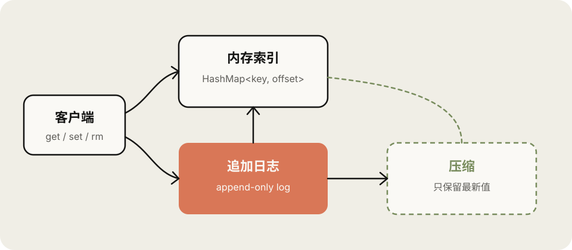
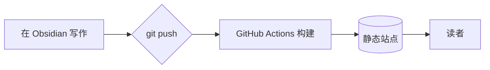
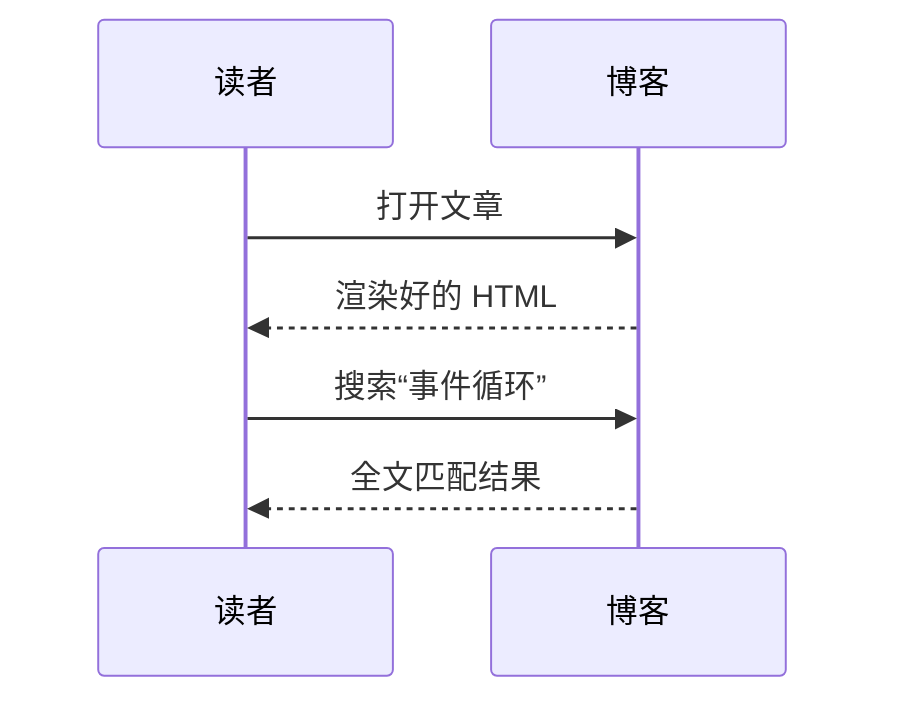

# Obsidian 语法全览

这篇文章既是**说明文档**，也是渲染测试。你在 Obsidian 里怎么写，这里就怎么显示。 #示例

%% 这是一段 Obsidian 注释，发布后不会出现在页面上。 %%

## 基础格式

**粗体**、*斜体*、***粗斜体***、~~删除线~~、==高亮文本==、`行内代码`，以及 <u>下划线</u>、<kbd>Ctrl</kbd> + <kbd>K</kbd>、H<sub>2</sub>O、E = mc<sup>2</sup>。

高亮里也可以嵌套格式：==这是 **加粗的** 高亮==。行内注释 %%看不见我%% 也会被移除。

中文标点紧挨着格式符号也没问题：**加粗（带括号）**紧跟文字、*斜体“引号”*、~~删除（线）~~都能正确渲染。

单个换行会被保留（Obsidian 默认行为），
就像这一行。

> 普通引用块。
> —— 某位智者

---

## 双向链接

- 链接到其它笔记：[[卡片盒笔记法]]
- 使用别名：[[卡片盒笔记法|Zettelkasten]]
- 链接到标题：[[卡片盒笔记法#核心原则]]
- 链接到块：[[卡片盒笔记法#^atomic]]
- 链接到本文的标题：[[#数学公式]]
- 通过别名找到笔记：[[写作指南]]
- 还没写的笔记会显示为虚线：[[一篇还不存在的笔记]]
- 普通 Markdown 链接也能指向笔记：[理解事件循环](../技术/前端/理解%20JavaScript%20事件循环.md)
- 外部链接：[Anthropic](https://www.anthropic.com)

> [!tip] 悬停预览
> 在桌面端把鼠标停在上面的内部链接上，可以预览目标笔记的内容，就像 Obsidian 的页面预览。

## 嵌入

### 嵌入整篇笔记的某个章节

![[卡片盒笔记法#核心原则]]

### 嵌入一个块

![[卡片盒笔记法#^atomic]]

### 嵌入图片（支持尺寸）

![[cover-reading.svg|这是一张示意插图|560]]

标准 Markdown 图片同样支持尺寸与图注：



## Callouts

> [!note]
> 默认标题来自类型名。

> [!abstract] 摘要
> Callout 支持 **任意 Markdown**，包括 `代码`、[[卡片盒笔记法|链接]]、列表：
> - 第一项
> - 第二项

> [!info] 信息

> [!todo] 待办
> - [ ] 写完这篇文章
> - [x] 配好博客

> [!success] 成功
> 构建通过。

> [!question]+ 可以折叠吗？（默认展开）
> 可以。在类型后面加 `+` 默认展开，加 `-` 默认折叠。

> [!warning]- 点我展开（默认折叠）
> 藏在折叠里的内容。

> [!failure] 失败

> [!danger] 危险
> 不要在生产环境直接 `rm -rf`。

> [!bug] 已知问题

> [!example] 示例

> [!quote] 引用
> 我们塑造了工具，工具也反过来塑造我们。

> [!info] 嵌套 Callout
> 外层内容。
> > [!tip] 内层
> > 支持多层嵌套。

## 列表与任务

1. 有序列表
2. 第二项
   - 嵌套无序列表
   - 另一项
     1. 更深一层

- [ ] 未完成
- [x] 已完成
- [/] 进行中
- [-] 已取消
- [>] 已推迟
- [<] 已排期
- [?] 有疑问
- [!] 重要
- [*] 星标
- ["] 引用
- [i] 信息
- [I] 灵感
- [b] 书签
- [p] 优点
- [c] 缺点

## 表格

| 语法 | 示例 | 说明 |
| :--- | :---: | ---: |
| 双链 | `[[笔记]]` | 链接到其它笔记 |
| 别名 | `[[笔记\|别名]]` | 表格里的竖线需要转义 |
| 高亮 | `==文字==` | ==像这样== |
| 嵌入 | `![[笔记]]` | 嵌入内容 |

## 代码

代码块首行的参数与 Obsidian 插件 [Codeblock Customizer](https://github.com/mugiwara85/CodeblockCustomizer) 一致：`file:` 标题、`ln:` 行号、`hl:` 行高亮、`hlt:` 文本高亮、`info:` / `warn:` / `error:` 等自定义颜色、`fold` 默认折叠。

```ts file:highlight.ts ln:true hl:3
export function greet(name: string): string {
  const time = new Date().getHours();
  const word = time < 12 ? '早上好' : '你好';
  return `${word}，${name}！`;
}
```

```python hl:4 hlt:3|range
def fib(n: int) -> int:
    a, b = 0, 1
    for _ in range(n):
        a, b = b, a + b
    return a
```

```js file:retry.js info:2 warn:6 error:9 fold
async function fetchWithRetry(url, times = 3) {
  for (let i = 0; i < times; i++) {
    try {
      return await fetch(url);
    } catch (err) {
      console.warn(`第 ${i + 1} 次请求失败`, err);
    }
  }
  throw new Error('重试次数已用完');
}
```

```diff
- const theme = 'light';
+ const theme = prefersDark ? 'dark' : 'light';
```

## 数学公式

行内公式 $e^{i\pi} + 1 = 0$，以及块级公式：

$$
\int_{-\infty}^{\infty} e^{-x^2}\,dx = \sqrt{\pi}
$$

$$
\begin{aligned}
\nabla \cdot \mathbf{E} &= \frac{\rho}{\varepsilon_0} \\
\nabla \times \mathbf{B} &= \mu_0 \mathbf{J} + \mu_0 \varepsilon_0 \frac{\partial \mathbf{E}}{\partial t}
\end{aligned}
$$

## Mermaid 图表





## 脚注

这里有一个普通脚注[^1]，还有一个行内脚注^[行内脚注直接写在正文里，适合简短的补充。]。

[^1]: 脚注内容会显示在文章末尾；桌面端把鼠标停在脚注编号上也能直接预览。

## 标签

行内标签： #obsidian #写作/技巧 #博客 。标签前需要有空格（与 Obsidian 规则一致），嵌套标签会同时计入父标签。

## 块引用

这一段有一个块 ID，可以被其它笔记精确引用。 ^showcase-block

## 嵌入搜索结果

```query
tag:#obsidian
```

## HTML 与其它

<details>
<summary>原生 HTML 的 details 元素</summary>

里面可以写 **Markdown**。

</details>

上面这些就是全部了。去 [[写作与发布指南]] 看看如何开始写作吧。
